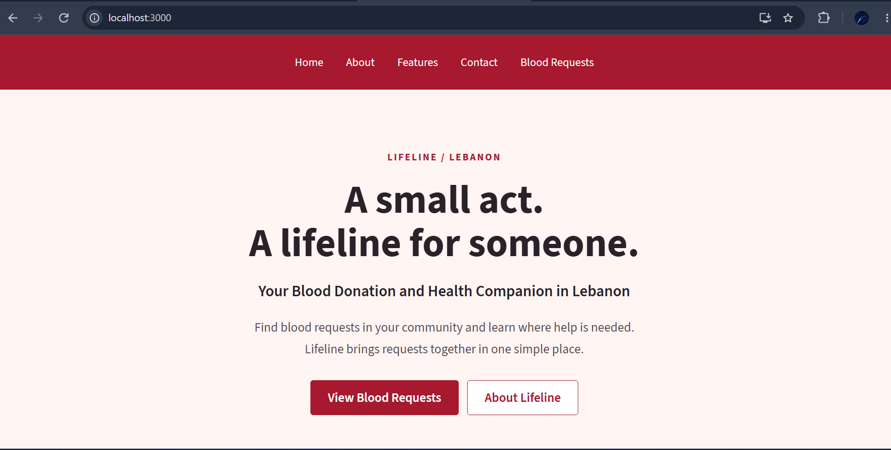
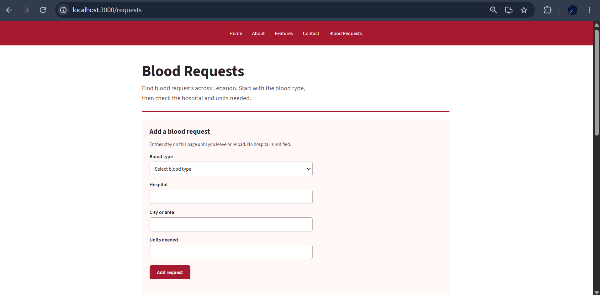
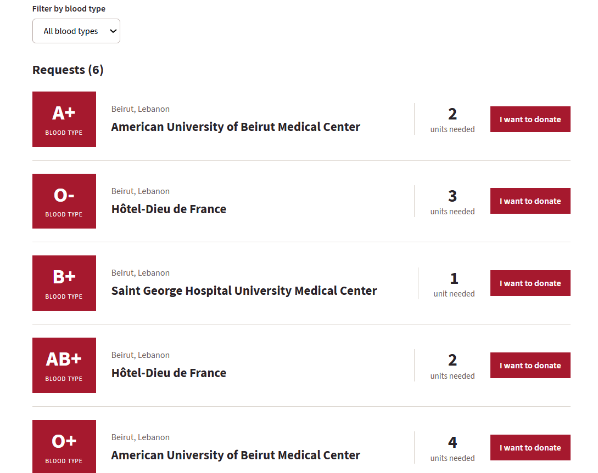
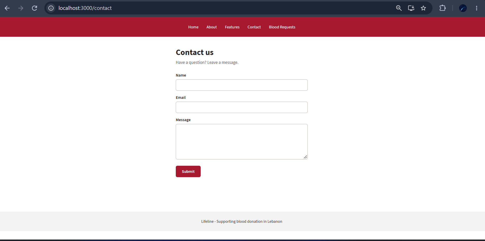

# Lifeline

Your Blood Donation and Health Companion in Lebanon.

My CSCI426 Phase 1 project at LIU Beirut. The idea is to put blood requests in one place so people can check the blood type, hospital, location, and units needed.

- **Name:** Hussein Hraibi
- **Course:** Advanced Web Programming
- **Working:** Solo

## Pages and features

- **Home:** introduces Lifeline and links to the requests.
- **About:** explains the idea behind the website.
- **Features:** shows what visitors can do.
- **Contact:** a form for name, email, and message, with input validation.
- **Blood Requests:** browse requests, filter by blood type, and add a request. Each existing request has a blood-type compatibility checker.

The navbar and footer are shared across the pages. CSS media queries adjust the layout for smaller screens.

## Tools used

React, JavaScript, React Router, HTML, CSS, Create React App, and Git.

The main React concepts are components, props, `useState`, forms, `.map()`, and `.filter()`.

## How to run

Install Node.js and npm. Open the terminal in the project folder, where `package.json` is located.

Install the packages:

```sh
npm ci
```

Start the website:

```sh
npm start
```

Open [localhost:3000](http://localhost:3000) in the browser. Press Ctrl+C in the terminal to stop it.

To make a production build:

```sh
npm run build
```

The result is saved in the `build` folder. On Windows PowerShell, `npm.cmd` can be used instead of `npm` if scripts are blocked.

## Folders

- `src/components`: navbar, footer, cards, and request forms.
- `src/pages`: the five pages.
- `src/data`: blood requests and blood-type compatibility data.
- `src/styles`: CSS files.
- `src/assets/fonts`: font files and license.
- `docs/screenshots`: screenshots of the website.

`App.js` contains the routes. `index.js` starts the React app.

## Phase 1 notes

This version is frontend only. The hospital names are real, but the requests and quantities are made-up data, not actual requests from those hospitals.

Added requests stay on the Requests page until it is closed or reloaded. Going to another page also resets them. New entries are marked "Your request" and do not show a donation button. There is no login or database.

The checker compares blood types for possible red blood cell compatibility. It does not confirm if someone is eligible to donate. The hospital still needs to do screening and cross-matching. It does not cover plasma or platelets.

The Contact form checks the inputs but does not send email.

## Screenshots

### Home



### Request form



### Blood requests



### Contact



## Live website

Deployment is not finished yet.

## References

- Font: [Source Sans 3 by Adobe](https://github.com/adobe-fonts/source-sans). The SIL Open Font License is included with the font files.
- Compatibility information: [American Society of Hematology](https://www.hematology.org/Resources/Patients/Blood-Basics/Blood-Banking-and-Donation/Blood-Safety-and-Matching).
- Hospital names: [AUB](https://www.aub.edu.lb/), [Hotel-Dieu de France](https://www.hdf.usj.edu.lb/en/contact-us), and [Saint George Hospital](https://www.stgeorgehospital.org/).
- Project setup: Create React App. The React structure follows the classroom examples.
